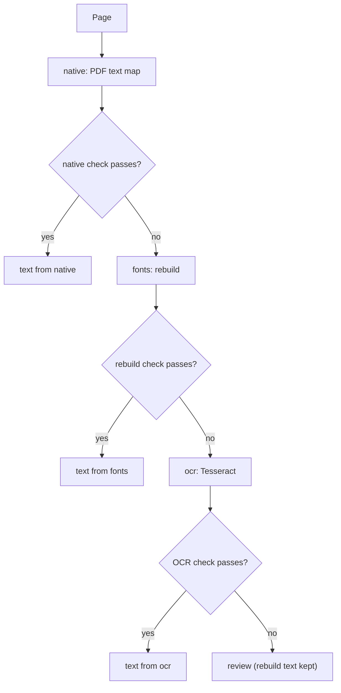

# pdf-ar

Arabic and English text extraction from PDFs, with no language model. It keeps reading order, tables (as Markdown), headers and footers, and drops text that is not visible. Each page's text comes from one of three engines:

| Engine | Text from | Needs |
|---|---|---|
| `native` | the PDF's own text map | nothing extra |
| `fonts` (default) | Arabic letters rebuilt from the full font files; English as in native | the fonts folder |
| `ocr` | Tesseract on the page image | Tesseract |

`auto` picks per page: native if its check passes, otherwise fonts, otherwise OCR, otherwise review.

Two optional checks work with any engine:

- `--ocr-check` records how far OCR agrees with the text;
- `--font-check` compares native text with the rebuild.

How each works is described under [Engines and how they work](https://github.com/oreaba/pdf-ar#engines-and-how-they-work).

## Why

Many Arabic PDFs, Word exports in particular, carry a broken text map: missing letters, words split apart, ligatures in reverse order. Copying their text, or reading it with a standard parser, gives corrupted Arabic. pdf-ar rebuilds each Arabic letter from the glyph that is actually drawn and the font's own shaping tables, and sends any page it cannot verify to review instead of guessing.

It was validated on a private corpus of Arabic and English Word-export PDFs:

- **Arabic:** on 20 held-out pages, checked against two independent OCR readings and confirmed by a reader, accepted pages scored word F1 0.999 and numeric F1 1.00, with a review false-alarm rate of 0.05.
- **English:** on 24 pages, the words match the PDF's own text (word F1 0.998), with better reading order and tables.

## Engines and how they work

Every engine reads the PDF through PyMuPDF, used only in [`pdf_adapter.py`](https://github.com/oreaba/pdf-ar/blob/main/src/pdf_ar/pdf_adapter.py). None of them uses a language model.

### `native`: the PDF's own text

- **How:** PyMuPDF gives each drawn glyph's position and the Unicode text the PDF assigns to it, its ToUnicode map. The layout pipeline then builds lines, words, reading order, table cells and paragraphs from those glyphs. It also drops hidden and off-page text and joins superscripts. This is the same pipeline the rebuild uses.
- **Needs:** no font files.
- **Good for:** English, and Arabic PDFs whose text map is intact.
- **English:** on 2,919 English pages, native text was identical to the rebuild on 2,778. The rest lose quotes and apostrophes that the PDF maps to nothing (`company’s` becomes `company s`).
- **Risk:** many Arabic PDFs have broken maps. The native check below catches most of them, but not all: on the same corpus, only 40% of the Arabic pages it accepted matched the verified rebuild. **For Arabic, use `fonts`, or `auto --font-check`.**

### `fonts`: the font rebuild

- **How:** the same pipeline as native, but the Arabic letters come from the full font file.
  - PyMuPDF gives each glyph's ID and the embedded font subset.
  - fontTools opens the matching file in the fonts folder and accepts a glyph only if its outline is identical to the file's.
  - The font's shaping tables (GSUB, GPOS, GDEF) then say which letter, form, ligature or dot each glyph is.
  - English glyphs keep the PDF's text, as in native.
- **Needs:** the fonts folder (see [Fonts](https://github.com/oreaba/pdf-ar#fonts)).
- **Good for:** Arabic. It is deterministic.

### `ocr`: Tesseract

- **How:** PyMuPDF renders the page at 300 DPI (`--ocr-dpi`), and Tesseract 5 reads it through pytesseract with `ara+eng` and the `fast` or `best` models (`--ocr-model`).
- **Layout:** Tesseract's own paragraphs and lines, with no table cells.
- **Needs:** Tesseract and its models. The Docker image includes both.
- **Good for:** scans and image-only pages, and as a fallback. It makes recognition errors (word F1 about 0.86 on Arabic in our tests).

### `auto`: native, then fonts, then OCR



- **Use it as `auto --font-check`** whenever fonts are available. The native check alone accepts Arabic text that differs from the rebuild. Without `--font-check`, `auto` is for PDFs whose fonts you cannot obtain.
- **Steps per page:** only as many as needed. It stops at the first engine whose check passes.
- **Missing fonts:** they never stop an `auto` run. For a font the fonts folder lacks, or has in a different version, `auto` reads this machine's installed files of that font, whatever their version. The rebuild only takes a glyph whose outline is identical, so a different version cannot change the text: pages with glyphs it does not match go on to OCR. The fonts table says which installed files were read and how many glyphs they match.
- **If every engine fails:** the page keeps the rebuild's text and goes to review.

A page moves on from native when the native check finds any of these:

| Reason | Meaning |
|---|---|
| `split_words` | more than 2% of Arabic words are single letters other than `و` (words broken apart) |
| `unmapped_glyphs` | more than 2% of drawn glyphs have no text in the PDF |
| `ligature_order`, `rtl_order` | ligatures or letters in reversed order |
| `broken_glyphs` | replacement characters, unprintable characters, presentation forms or unmapped letters |
| `spacing` | more than 30% single-character tokens |
| `numeric_order` | document codes written backwards |
| `too_little_arabic` | the page has Arabic but fewer than 20 Arabic words, too few to judge |
| text signals | the same signals as the rebuild's gate (below) |

The limits are `NATIVE_LIMITS` in [`qc.py`](https://github.com/oreaba/pdf-ar/blob/main/src/pdf_ar/qc.py), and the measures are in [`textstats.py`](https://github.com/oreaba/pdf-ar/blob/main/src/pdf_ar/textstats.py). Pages without Arabic face only the checks that apply to any script.

### The two checks

- **`--ocr-check`:** runs OCR on every page as well, writes its text next to the page text, and records the share of words OCR also reads (`ocr_agreement`). The page text and status never change. Use it to rank pages for review.
- **`--font-check`:** works with `auto` and `native`. On pages native accepted, it also runs the rebuild. If both pass and their text differs, the page keeps the verified rebuild, with `native_disagrees: true`. It catches what the native check misses, at the cost of the rebuild's time and its need for fonts.

### What the report says

Each page in `report.json` records:

- `source`: the engine whose text the page carries (`native`, `fonts` or `ocr`);
- `tried`: for `auto`, why each earlier engine failed, for example `["native: split_words", "fonts: missing_font"]`;
- `native_disagrees`: the result of `--font-check`.

`summary.csv` (`page_sources`) and `run.json` count pages per source.

## Why the rebuild needs font files

PDFs embed only subsets of their fonts. A subset holds the glyph outlines but not the shaping tables (GSUB, GPOS, GDEF) that say which glyph is which letter, form, ligature or dot. The tool reads those tables from the full font file. It uses a glyph only when the embedded outline is identical to the font file's outline, so a different font version can never change the text silently; such glyphs send the page to review.

## Install

Python 3.11 or later:

```
pip install pdf-ar            # PyMuPDF and fontTools
pip install "pdf-ar[ocr]"     # adds pytesseract
```

Or from a clone of the [repository](https://github.com/oreaba/pdf-ar):

```
git clone https://github.com/oreaba/pdf-ar.git
cd pdf-ar
pip install -e ".[ocr,dev]"
```

OCR (the `ocr` and `auto` engines, and `--ocr-check`) also needs Tesseract 5 with the `ara` and `eng` models, installed outside pip:

- **Linux:** `apt install tesseract-ocr`, then the models below.
- **Windows:** the [UB Mannheim installer](https://github.com/UB-Mannheim/tesseract/wiki), then the models below. Pass `--tesseract-cmd` if `tesseract.exe` is not on `PATH`.
- **Models:** `ara.traineddata` and `eng.traineddata` from [tessdata_fast](https://github.com/tesseract-ocr/tessdata_fast) into `<root>/fast`, and from [tessdata_best](https://github.com/tesseract-ocr/tessdata_best) into `<root>/best`. The [Dockerfile](https://github.com/oreaba/pdf-ar/blob/main/Dockerfile) pins the 4.1.0 files by SHA-256.

PyMuPDF is AGPL-3.0 or commercial. It is used only in `pdf_adapter.py`, so another library that exposes glyph IDs, positions and drawings can replace it there.

## Use

```
pdf-ar fonts   <pdf or folder> [--fonts-dir fonts] [--out artifacts/pdf-ar]
pdf-ar extract <pdf or folder> [--engine auto|native|fonts|ocr]
                              [--ocr-check] [--font-check] [--format txt,md,json]
                              [--out artifacts/pdf-ar] [--fonts-dir fonts]
                              [--pages 1,3-5]
                              [--ocr-model fast|best] [--tesseract-cmd ...]
                              [--tessdata-dir ...] [--ocr-lang ara+eng]
                              [--ocr-dpi 300] [--ocr-psm 3] [--min-ocr-confidence 0.75]
pdf-ar report  <out folder>
```

`python -m pdf_ar` works the same way. Where Windows application control blocks new launchers, use `python -m pdf_ar`.

The `fonts` and `auto` engines, and `native --font-check`, first check every font the PDFs need against the fonts folder, as described below. If one is missing or a different version, `fonts` and `native --font-check` stop with exit code 2 before anything is extracted, while `auto` goes on with this machine's installed versions of those fonts and prints the table of what to add. `native` and `ocr` need no fonts and skip the check.

`--ocr-model` chooses the Tesseract models:

- `fast` (the default) uses `tessdata_fast`, which is quicker.
- `best` uses `tessdata_best`, which is slower and slightly more accurate. In our tests, Arabic word F1 was about 0.86 for both.

The models are read from `<root>/fast` or `<root>/best`. The root is `PDF_EXTRACT_TESSDATA` if it is set, otherwise `%LOCALAPPDATA%/pdftext-tools/tessdata`. `--tessdata-dir` names an exact model folder and overrides `--ocr-model`.

### From Python

```python
from pathlib import Path
from pdf_ar.extract import Options, run

result = run(Path("manual.pdf"), Options(out_dir=Path("out"), fonts_dir=Path("fonts"),
                                         engine="fonts", formats=("txt", "md")))
print(result.pages, result.review_pages)
```

`run` writes the same files as the command and raises `MissingFontsError` where the command exits with code 2.

### Fonts

The fonts folder (default `./fonts`) holds only the font files you put there. Fonts are never downloaded and never copied in automatically. The workflow is:

1. Run `pdf-ar fonts <folder of PDFs>`. It prints a table and writes `fonts_report.csv` and `fonts_report.json` (the JSON also lists each row's documents) to `--out`.
2. Add the fonts the table asks for to the fonts folder.
3. Run `fonts` again until it reports every needed font, then run `extract`.

The table has one row per font and per version the PDFs embed ([`required_fonts.py`](https://github.com/oreaba/pdf-ar/blob/main/src/pdf_ar/required_fonts.py)):

| Column | Meaning |
|---|---|
| `font`, `version` | the font's name in the PDF and the version its embedded copy records |
| `documents`, `pages` | how many PDFs and pages use it for Arabic (or for glyphs mapped to no character) |
| `glyphs`, `matched`, `unreadable` | the distinct glyphs needed, those whose outline is identical in a folder file, and those the PDF's own copy does not let us read |
| `files`, `matched_by` | the folder files for the font, found by `name`, or by `shape` for a font whose name the PDF does not record (for example `9`) |
| `status` | see below |
| `hint` | where to find the font: a file of that version on this machine, the pinned open-font source in [`open_fonts.toml`](https://github.com/oreaba/pdf-ar/blob/main/src/pdf_ar/data/open_fonts.toml), or its vendor |
| `installed`, `installed_matched` | `auto` only: this machine's files it read in place of a missing font, and how many of the glyphs they match |

| Status | Meaning | Stops `fonts` (never `auto`) |
|---|---|---|
| `ok` | every readable glyph matches a folder file: the same version, or another version with identical outlines | no |
| `partial` | the folder has the same version and at least 90% of the glyphs match: the PDFs were made with another build of it; pages with the other glyphs go to review | no |
| `wrong_version` | the folder has the font, but too many glyphs differ; add the version the row names | yes |
| `missing` | the folder has no file for the font | yes |
| `unreadable` | the PDFs' copies of the font cannot be read, so no file could help | no |

Only visible glyphs count, and English-only pages need no fonts. A glyph counts as matched only when its outline is identical, the same test the rebuild applies, so one file can serve several versions. For example, one `calibri.ttf` matched every glyph of Calibri 6.23, 6.26 and 6.27 in our tests.

`run.json` records the folder's files with their versions and SHA-256. Microsoft fonts may not be redistributed, so copy them only to machines licensed to use them.

### Outputs

For each PDF, mirroring the input folders, `--format` chooses which document files are written (default `txt`):

- `<stem>/<stem>.txt` (`txt`): paragraph text, with pages separated by a form feed.
- `<stem>/<stem>.md` (`md`): Markdown.
  - Ruled tables become Markdown tables, with their columns in reading order (right to left for Arabic tables). A merged cell fills its first row and column.
  - Drawn boxes, such as flowchart steps, and single framed cells become paragraphs.
  - Each page starts with `<!-- page N -->`.
- `<stem>/<stem>.json` (`json`): every page's status, reasons and text, and its blocks in reading order. Each block has a kind (`paragraph`, `cell` or `box`), its text and lines, its position in page points, and its direction.

These files are always written:

- `<stem>/pages/page-NNN.txt`: one page's paragraphs.
- `<stem>/pages/page-NNN.lines.txt`: one page's lines as laid out in the PDF (font rebuild) or as Tesseract found them (OCR), for citing exact lines.
- `<stem>/report.json`: per-page engine, status and reason codes, where each glyph's text came from, word counts, timing, and the OCR confidence and agreement. Its `sources` also count the glyphs dropped as invisible:
  - `hidden`: invisible text, or text painted over by a later opaque box;
  - `off_page`: text drawn wholly outside the page.

With `--ocr-check`, the OCR text is written next to the page text as `<stem>.ocr.txt`, `page-NNN.ocr.txt` and `page-NNN.ocr.lines.txt`.

For the whole run: `summary.csv`, `fonts_report.json` and `run.json`. All text is UTF-8 with `\n` line endings.

### The page gate

Each engine has its own check:

- **Font rebuild:** a page is `ok` only if every Arabic glyph was read from a verified font file and none of the known corruption signals appear.
- **Native:** see the table under [`auto`](https://github.com/oreaba/pdf-ar#auto-native-then-fonts-then-ocr).
- **OCR:** a page is `ok` if Tesseract read text with a mean word confidence of at least `--min-ocr-confidence` and none of the text signals appear.

Otherwise the page is `review`, with one or more of these reasons:

| Reason | Meaning |
|---|---|
| `missing_font` | Arabic glyphs in a font the folder does not have (in `auto`, when this machine has no version of it either; `fonts` stops first) |
| `unverified_glyphs` | glyph outlines differ from the font file (another font version) |
| `unresolved_glyphs` | the font tables do not name a glyph |
| `orphan_marks` | a dot or vowel mark could not be attached to a letter |
| `odd_letters` | dotless, Persian or presentation-form letters, or kashida, left in the text |
| `swapped_article`, `medial_alef_maksura`, `initial_teh_marbuta` | text patterns of reversed or misordered Arabic |
| `unbalanced_brackets` | a paragraph whose brackets do not pair |
| `no_text_layer` | an image-only page (use `--engine ocr`) |
| `ocr_empty` | OCR read nothing on a page that has text or images (OCR engine) |
| `low_ocr_confidence` | OCR mean word confidence below the threshold (OCR engine) |
| `error` | the page could not be processed |

A flag is not proof of an error: a typo in the source can trip it. `--ocr-check` never changes a page's text or status. Pages in `review` should be checked against the page image before their text is used.

## Docker

The [`Dockerfile`](https://github.com/oreaba/pdf-ar/blob/main/Dockerfile) builds a CPU-only image with:

- Python 3.13;
- PyMuPDF 2.1 and fontTools 4.68.0, the versions of the validated runs;
- Tesseract 5, with the `ara`, `eng` and `osd` models from `tessdata_fast` and `tessdata_best` 4.1.0, each pinned by SHA-256.

Font files are licensed, so they are never built into the image. You mount them.

The layers total about 490 MB; `docker images` shows about 700 MB. PyMuPDF 2.1's layout and LLM add-ons (onnxruntime, numpy, networkx), which pdf-ar never uses, are removed in the build, and so is pip.

### Build

From the repository root:

```
docker build -t pdf-ar .
```

[`.dockerignore`](https://github.com/oreaba/pdf-ar/blob/main/.dockerignore) keeps fonts, outputs and `.venv` out of the build. The build downloads the Python packages and the Tesseract models once. The finished image needs no network.

For an air-gapped machine, move the image as a file:

```
docker save pdf-ar -o pdf-ar.tar    # on the connected machine
docker load -i pdf-ar.tar               # on the air-gapped machine
```

### Use

The container works in `/data`. Mount a folder there that holds the PDFs, and a `fonts/` folder holding the fonts the `fonts` command asks for. Outputs are written under the same mount. The container never downloads fonts, and has no system fonts of its own.

```
# PowerShell
docker run --rm -v "${PWD}:/data" pdf-ar extract input --out output --format txt,md,json
# Linux or macOS (run as your own user so the output files are yours)
docker run --rm --user "$(id -u):$(id -g)" -v "$PWD:/data" pdf-ar extract input --out output
```

Other commands:

- `fonts input --out output`: the table of fonts and versions the PDFs need, and whether `/data/fonts` has them (`output/fonts_report.csv`).
- `extract input --engine ocr --ocr-model best`: OCR with the bundled `tessdata_best` models. It needs no fonts.
- `extract input --ocr-check`: font rebuild plus OCR agreement.
- `extract input --engine auto --font-check`: native where it passes, then fonts, then OCR, with native checked against the rebuild.
- `report output`: summarize a finished run.

## Tests

```
pip install -e ".[ocr,dev]"
pytest
```

The fixture `tests/fixtures/arabic_ligatures.pdf` is a Word export of four synthetic Arabic sentences, and `arabic_ligatures.txt` holds the expected lines. Tests that need Arial (the fixture's font) or Tesseract are skipped where those are missing.

## Limits

- **Span order:** the reading order inside a text span follows Word's convention, where glyphs are written left to right. Other producers may differ.
- **Layout:** tables and flowcharts are read cell by cell and box by box.
  - Boxes and cells side by side are read in the direction of their own text: right to left for Arabic, left to right for English.
  - A box whose top edge is lower than its neighbours', such as a round `Start` node, can come after them.
- **Superscripts:** a raised run of up to four glyphs joins the word it is raised from, as on the page (`21st`, a footnote mark).
- **Fonts:** fonts without shaping tables, or embedded in a converted outline format, cannot be verified. Their pages go to review.

## License

[AGPL-3.0](https://github.com/oreaba/pdf-ar/blob/main/LICENSE). PyMuPDF, which pdf-ar requires, is itself AGPL-3.0 or commercial.
